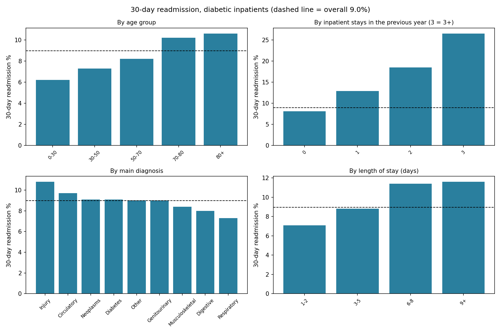
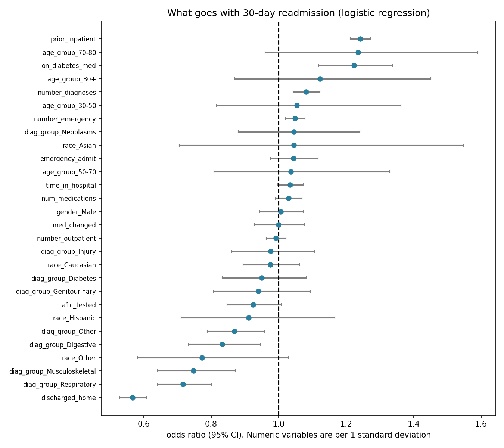

# Who comes back within 30 days? Readmission in diabetic inpatients

Hospitals get penalised for patients who return within 30 days, so readmission is one of the most studied questions in hospital analytics. This project looks at it for diabetic inpatients: how big the problem is, which patients are most at risk, and how much a simple model can really predict.

## Data
- "Diabetes 130-US hospitals for years 1999-2008", UCI Machine Learning Repository: https://archive.ics.uci.edu/dataset/296
- 101,766 hospital encounters from 130 US hospitals, 71,518 different patients, 50 columns (age, diagnoses, medications, lab tests, length of stay, discharge, readmission).
- The raw file (19 MB) is not in this repo. Download `diabetic_data.csv` and `IDS_mapping.csv` from https://archive.ics.uci.edu/dataset/296 and put them in `data/` before running `src/analyze.py`. The script builds the SQLite database itself.

## Cleaning choices
- One row per patient (their first encounter in the data). The same person appearing many times would make the results look more certain than they are.
- Removed patients who died or went to hospice at discharge (they cannot come back). That leaves 69,973 patients.
- Outcome: readmitted in under 30 days, yes or no.
- Primary diagnosis grouped from ICD-9 codes into 9 groups (circulatory, respiratory, digestive and so on).
- Age grouped into 5 bands. "A1C tested" means an HbA1c result was recorded during the stay.

## Method
1. Load the cleaned table into SQLite and explore it with SQL (`src/analyze.py`, results saved as `data/sql_*.csv`).
2. Logistic regression to get odds ratios, with 70% of patients for fitting and 30% held out for testing. Numbers in the model are standardised, so an odds ratio for them means "per 1 standard deviation". Reference groups: age 0-30, main diagnosis circulatory, female, African American.
3. Score the held-out patients and measure AUC.

## Findings
- Overall, 9.0% of these patients were readmitted within 30 days.
- Prior stays matter most. Readmission is 8.1% for patients with no inpatient stay in the previous year, 12.9% with one, 18.5% with two, and 26.5% with three or more.
- Where the patient goes after discharge matters: 6.9% when discharged home, 12.5% to anywhere else (nursing facility, other hospital, home health and so on). In the model, discharge home has an odds ratio of 0.57.
- Length of stay and age go up together with risk: 7.1% for stays of 1-2 days versus 11.6% for 9+ days, and 6.2% for ages 0-30 versus 10.6% for 80+. After adjusting for the other factors, the age differences are not statistically clear.
- Main diagnosis: respiratory admissions had the lowest readmission (7.3%), injuries the highest (10.8%).
- HbA1c testing and medication changes show only small differences in the simple rates and none after adjustment. I would not read anything into them from this data alone.
- The model is weak. AUC on held-out patients is 0.625 (0.5 is a coin flip). The available fields do not predict readmission well, which matches what published studies on this dataset find.




## Limits
- Data is old (1999-2008) and from the US, so it says little about Saudi hospitals today.
- It is observational. Patients who stay longer are sicker. These are associations, not effects of any treatment.
- Many fields are mostly missing (weight 97%, HbA1c result 83%), so I did not use them beyond the "tested" flag.
- Only the first encounter per patient is used, and the readmission label comes from the dataset as given.

## Reproduce
```
pip install pandas numpy scipy matplotlib
python src/analyze.py
```

## Next steps
Try gradient boosting and compare it with this baseline, add calibration plots, and test whether the weak result changes if all encounters are used with patient-level grouping.
